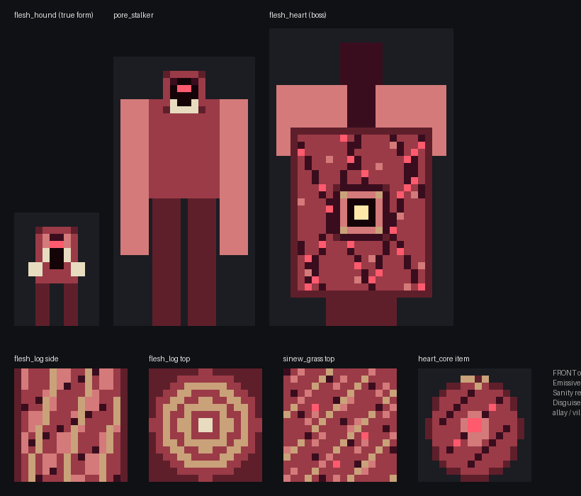

# DRAFT — The Flesh Forest (`flesh_forest`): an illusion biome gated by EP

Status: **design draft, not built.** Requested by Ben 2026-10-24: a forest that looks idyllic and resource-rich
(fairies, villages, ore spires, friendly-looking wolves) and lures weak players into caves around the spires,
where hard-to-see hostiles wait. Above X EP you sense something is wrong; above Y EP you can force yourself out
of the illusion and see a flesh forest whose caves are pores converging on a heart boss. This sheet is the
recommendation plus the SpecBlocks a build session needs. Hero faces carry palette grids; the remaining faces
and block textures are `pending` until Ben approves the direction (then a mockup pass fills them).

Concept sanity render (front ortho, from the grids in Appendix A; not the data):



---

## 1. The pitch in one paragraph

You find a valley that is almost too good: candy-bright azalea canopy, a village every few hundred blocks, crystal
spires studded with diamond and gold, tame-looking wolves that wag and walk ahead of you, fairies that dance
toward a cave mouth at the spire's foot. None of it is real. The whole biome is one living organism wearing a
glamour, and the glamour only works on the weak. Low-EP players see a paradise and get led into the pores; the
caves look like ordinary stone tunnels where something shimmering keeps killing them. Stronger players get an
uneasy System line and glimpses of meat through the leaves. The strongest can tear the illusion off and see the
flesh forest as it is, walk the pores down to the heart, and kill it for a core that feeds blood magic or a
martial body.

---

## 2. Grounding and sources

**This biome is original pack content, not canon.** Per the GDD's pillar 4 ("lore invented and presented as canon"
fails), it is presented in-game as a monster of this world, not a Tensura location. What it borrows from the
source, and how strong each source is:

Strength key: **[S]** primary/strong, **[F]** fan wiki, **[P]** our own pack (questbook text or code), **[R]** my
recall, not re-verified this session.

| Idea used here | What the source says | Source |
|---|---|---|
| Perception scales with power | Tensura's Heavenly Eye "can reveal magicules and other spiritual matter, gauge their strength", a superior Observing Eye that makes Mana Perception obsolete | [F] [Tensura wiki: Heavenly Eye](https://tensura.fandom.com/wiki/Heavenly_Eye) |
| Heavenly Eye pierces illusions in this pack | Questbook quest "Heavenly Eye": "see through illusions, track the unseen" (requires 50,000 Max EP) | [P] `config/ftbquests/quests/lang/en_us.snbt` |
| Magic Sense sees mobs through walls | Questbook quest "Magic Sense": "perceive mana, see mobs through walls" | [P] same file |
| Sage / Great Sage appraise the world | Sage (10,000 Max EP gate) and Great Sage (100,000 Max EP gate) in the questbook | [P] same file |
| Weak beings are overwhelmed by strong ones | Tensura's Coercion compares `getMaxEP` caster vs target; below 2x no effect | [P] `docs/pressure-coercion-scoping.md` (decompiled 2026-07-03) |
| A guarding forest spirit (Dryads of Jura) | Treyni and the Dryads are the wardens of the Jura Great Forest | [F] [Tensura wiki: Dryad](https://tensura.fandom.com/wiki/Dryad) |
| Rank ladder for the thresholds | D 1k, C 3k, B 6k, A 10k, Special-A 100k, S 400k, SS 800k EP | [P] questbook `tr_00_journey` + `docs/game-design.md` |
| Martial path = aura + battlewill | "Battlewill Manual ... the martial counterpart to magic"; Wastelander becomes a cultivator (Mortal Cultivation) | [P] questbook; `docs/backlog.md` (TenSura: Nightmare `martial_line.json`) |
| Blood magic in the pack | Iron's Spells **blood** school (mastery lane `irons.blood`, cap 35); EvilCraft blood economy; Vampirism | [P] `mahoumagicule_build/.../MasteryConfig.java`, questbook ch. 9 and 20 |

I found no canon source for an illusion that hides a whole living biome; the Dryad link is flavour only (a
corrupted mirror of a forest warden), not a claim that Tensura has one.

---

## 3. The recommendation

**Build it as a new mod, `isekai_wilds`** (biomes, structures and their resident mobs), not inside
`isekai_beasts`. The biome, its blocks, its mobs and the client illusion renderer are one coupled feature, and the
illusion engine is reusable (a later Kitsune glamour, a Demon Gate mirage). Default spawn: rare overworld biome
via TerraBlender, temperate forest climate.

**The core rule: the server always holds the truth; only the client lies.** Every block in the biome IS a flesh
block, every friendly-looking mob IS a hostile organism with real stats. Each player gets a perception tier,
computed on the server and synced only to that player's client. The client then chooses which model to draw.
Two players standing side by side can see different worlds, and neither can cheat the server.

Why this shape:
- No fake block swapping, no per-player chunk packets, no server state that can desync. One flag per client.
- Disguised mobs reuse vanilla models and textures (wolf, villager, allay), so the illusion layer costs almost no
  art: only the true forms need palette grids.
- Every illusory block is a flesh block paired with a vanilla "twin" block whose model it borrows, so the forest
  looks exactly like vanilla flora until it doesn't.

---

## 4. Perception tiers (the EP thresholds)

`effective_ep = EnergyHelper.getMaxEP(player) x skill multipliers` (standing power, not the drainable pool, the
same choice Coercion and our Pressure skill make; `EnergyHelper.getMaxEP` is already called by
`magicule_standard`'s `PressureResolver`, so the API is known to compile).

| Tier | id | Condition (defaults) | What the player gets |
|---|---|---|---|
| 0 | `deceived` | `effective_ep < notice_ep` (10,000, A-Rank) | full paradise; lures lead you; cave mobs shimmer almost invisibly |
| 1 | `uneasy` | `notice_ep <= effective_ep < pierce_ep` | one System line on entry ("The magicule here beats like a pulse. Something is wrong with this forest."); rare one-frame flickers of the true texture on blocks and mobs; cave mobs a little more visible |
| 2 | `lucid` | `effective_ep >= pierce_ep` (100,000, Special-A) **or** `SkillUtils.canSeeIllusion(player)` | System line offers the break: "[Break the illusion]" (clickable) or hold sneak 3 s |
| 3 | `pierced` | lucid player who broke it (persistent per player) | the true flesh forest: true blocks, true mobs, true sounds, red fog. Lures turn hostile on sight |

Skill multipliers (defaults; skill ids are the ones the questbook already grants):
- `tensura:magic_sense` x2 (a 5k B-Rank with Magic Sense is uneasy)
- **Tensura's own illusion rule (verified by javap, 2026-10-24, in the Detection list thread):**
  `SkillUtils.canSeeIllusion` is `presence_sense >= 3.0`. Universal Perception and Godwolf Sense give 3, Heavenly
  Eye gives 4. So any player Tensura already says can see illusions is `lucid` regardless of EP. This replaces the
  earlier Heavenly Eye x5 multiplier idea and matches the questbook's "see through illusions" promise.
- `tensura:sage` / `tensura:great_sage`: no multiplier; they change the copy (the uneasy line is spoken by
  [Sage]; Great Sage names the organism: "Analysis complete. This forest is a single living being.")

Hard overrides:
- **The heart chamber always shows the truth.** Entering it shatters the glamour for everyone (a scripted reveal:
  screen shake via `EffectStorage.setCameraShake`, the fog turns red, a System line). Nobody fights an invisible
  boss.
- Breaking the illusion costs `pierce_magicule_cost_fraction` (5%) of max magicule, once. Pillar 1.
- Tier only ever rises. Leaving and re-entering never re-deceives a pierced player.

### Intentional tells (rewards for paying attention, not bugs)
- Glamoured loot can't be crafted with (a "diamond" that no recipe accepts).
- Death messages always use the true name ("Ben was slain by a Flesh Hound").
- Tensura appraisal/analysis skills read the true entity name.
- The biome's ambient magicule is high (+3,000), which mages will notice on the gauge.

### Known leaks to plug (build checklist)
- **Jade** shows block and entity names: block `getName` and entity `getDisplayName` return the glamour key while
  the local client is below `pierced` (client-held flag read through a common holder, no client classes on the
  server).
- **Xaero's minimap / world map** colour from block models or map colours: give flesh blocks the twin's
  `MapColor` while glamoured is not possible per client (MapColor is server data), so default to the twin's map
  colour always (the map shows a forest) and accept that the truth never shows on the map. Verify in-game.
- **Explorer's Compass** lists structure ids: add `isekai_wilds:flesh_warren` and `isekai_wilds:mimic_village` to
  its structure blacklist config.
- **F3** shows the biome id `isekai_wilds:flesh_forest`. Accepted (debug screen). Display name in the lang file is
  the glamour name, "Gleaming Grove".

---

## 5. Client illusion engine (how the lie is drawn)

Server side (common classes, no `net/minecraft/client` refs):
- `PerceptionTracker`: every `tier_check_interval_ticks` (40) for players inside the biome or the warren, compute
  the tier, store the persistent `pierced` flag in a player attachment, and send `PerceptionTierPayload(tier)` to
  that player only when it changes. Same pattern as `magicule_standard`'s `PressurePulsePayload`.
- Gameplay reads the tier server-side: lure AI targets only `deceived`/`uneasy` players, glamoured drops, the
  reveal ambush.

Client side (`client` package, `Dist.CLIENT`):
- **Blocks:** every flesh block has a vanilla twin with the same blockstate properties (log `axis`, leaves
  `distance`/`persistent`, door `facing`/`half`/`open`...). On `ModelEvent.ModifyBakingResult`, wrap each flesh
  block state's baked model in `IllusionBakedModel(trueModel, twinModel)`; `getQuads` returns the twin's quads
  unless the local tier is `pierced` (or a flicker frame is active). On tier change call
  `Minecraft.getInstance().levelRenderer.allChanged()` once (a single chunk-rebuild hitch, happens at most twice
  per player ever).
- **Tint:** a `BlockColor` handler on flesh leaves/grass returns the biome foliage colour while glamoured and a
  fixed `flesh_base` tint when pierced.
- **Fog/sky:** `ViewportEvent.ComputeFogColor` + `RenderFog` push red fog only when pierced. The biome JSON's own
  effects are the paradise (bright sky, cyan water, birdsong).
- **Sound:** biome ambient = birds. Pierced clients start a looping heartbeat `SoundInstance` and duck the biome
  ambience.
- **Mobs:** each disguised entity's renderer holds two models: the vanilla disguise (`WolfModel`, `VillagerModel`,
  `AllayModel` with a tint) and the true code model. `render()` picks by tier. Cave mobs render translucent at
  `stalker_alpha` (0.15 deceived, 0.45 uneasy, 1.0 lucid/pierced) plus a faint shimmer particle.
- **Items:** glamoured items carry an item property `isekai_wilds:glamoured` (1 while the local tier is below
  `pierced`); the item model JSON overrides to the twin's model (diamond, gold ingot, emerald). Pure data.

Build risks (spike these first, in order):
1. `IllusionBakedModel` under **Sodium 0.8.12 + Iris 1.8.14** (both in the pack). Sodium on NeoForge honours
   custom `BakedModel.getQuads`, but confirm the swap and `allChanged()` rebuild in-game.
2. Translucent entity rendering under Iris shaders: mobs going see-through under shaders is already a known
   deferred issue, so `stalker_alpha` may look different with shaders on. Fallback mode
   `stalker_visibility = particles_only` (no body, only shimmer particles) is in config.
3. `presence_concealment` is an entity attribute, not per-viewer: decide whether stalkers drop it when the
   *nearest* player is pierced or only inside the heart chamber (default: chamber + when attacked by a pierced player).
4. TerraBlender 4.1.0.8 `Region` API and surface rules: check by javap before writing the region class.

---

## 6. The biome, blocks and structures

### 6.1 Biome `flesh_forest` (display "Gleaming Grove")
```
type: datagen + event_handler   content_id: flesh_forest   modid: isekai_wilds   host: none
placement: TerraBlender overworld region, weight 2 (rare), temperature 0.6-0.9, humidity 0.6-1.0, low erosion
features: flesh trees (twin oak/flowering azalea), pustule blooms (twin allium/peony/cornflower),
          vein vines (twin vine), ore spires (part of the warren structure, see 6.3)
spawns:   flesh_hound (pack 2-4), pore_moth (3-6), surface monster cap off (no zombies: the paradise is quiet)
effects:  sky #9fd6ff, fog #d9f2ff, water #3fd8e8, grass/foliage vivid  (the glamour)
magicule: kubejs/data/isekai_wilds/biome_magicule/flesh_forest.json  ADD 3000, regen ADD 15
```
Magicule file follows the verified format already shipped for `minecraft:cherry_grove` (+2500, regen +10):
```
{ "biome": "isekai_wilds:flesh_forest", "modifiers": [ { "mode": "ADD", "value": 3000.0 } ],
  "priority": 1, "regen_modifiers": [ { "mode": "ADD", "value": 15.0 } ] }
```
Datapack magicule only applies to newly generated chunks and needs a restart (already verified). No real world
exists yet, so that's free.

### 6.2 Blocks (flesh block -> vanilla twin)
| content_id | twin | drops (true) | notes |
|---|---|---|---|
| `flesh_log` | `oak_log` | `flesh_log` | axis property shared |
| `flesh_leaves` | `flowering_azalea_leaves` | `raw_flesh` (5%) | tinted |
| `sinew_grass` | `grass_block` | `flesh_soil` | emissive pustules |
| `flesh_soil` | `dirt` | itself | |
| `vein_vine` | `vine` | `vein_vine` | |
| `pustule_bloom` | `allium` / `peony` / `cornflower` (three variants) | `bile_sac` | |
| `marrow_node` | `diamond_ore` | glamoured: `glamoured_gem`; true sight: `marrow_shard` | ore spires |
| `bile_node` | `gold_ore` | glamoured: `glamoured_gem`; true sight: `bile_sac` x2 | ore spires |
| `calcified_spire` | `calcite` | `bone_meal` x2 | spire body |
| `pore_rim` | `mossy_cobblestone` | itself | pore mouths |
| `flesh_wall` | `stone` | `raw_flesh` | warren tunnels |
| `flesh_plank` | `oak_planks` | itself | mimic village |
| `cartilage_brick` | `cobblestone` | itself | mimic village |
| `membrane_pane` | `glass_pane` | nothing | mimic village |
| `sphincter_door` | `oak_door` | itself | mimic village |

"Drops (true)" means the server truth. Which drop table runs is chosen server-side by the breaker's tier, so a
deceived player mining a "diamond" gets a `glamoured_gem`. A `glamoured_gem` reverts (client shows its true
sprite, the bait was never real) once the holder's tier reaches `pierced`. Glamoured gems are not worthless:
they smelt to `bone_meal` x3, so they're compost, not loot.

True materials (`raw_flesh`, `marrow_shard`, `bile_sac`) are pierced-only resources and feed the reward recipes
(section 8). Hook for pillar 2: `raw_flesh` is valid input for EvilCraft's Blood Extractor-style blood (check the
EvilCraft recipe type by javap before promising it).

### 6.3 Structures
- **`flesh_warren`** (jigsaw, one per biome patch; spacing 40 chunks, separation 20). Start piece:
  `heart_chamber` at y -20 under the patch centre. Tunnel pieces branch up and out (max depth 12,
  `max_distance_from_center` 112) and terminate in **`pore_mouth` surface pieces**, each topped by an **ore
  spire** (12-20 tall, `calcified_spire` + `marrow_node`/`bile_node` studs). So every spire stands over a pore,
  and every pore leads to the heart: Ben's "caves converge at the heart" is the structure's own topology.
  Tunnels are `flesh_wall` (twin stone, so deceived players see a normal cave) with `pore_stalker` and
  `bile_weeper` spawners in side chambers. The heart chamber is a 30x24x30 cavity, 4 `heart_artery` anchors on
  the walls.
- **`mimic_village`** (jigsaw, 2-3 per biome patch, biome-tag gated): plains-village layout built only from
  twinned blocks, 4-8 `skin_puppet`s. No beds, no workstations that work (a tell). Every house has a path leading
  toward the nearest spire.

---

## 7. Mob roster (SpecBlocks)

Model convention for this sheet: `offset` = the cuboid's minimum corner `[x,y,z]` in entity space (model px,
+Y up, feet at y=0, forward = -Z); `pivot` absolute in the same space. `rot` signs are written as intent ("tip
raised") plus a value; **the sign of each non-zero `rot` is unchecked until the testkit turntable renders it**
(per Ben's rule: rotations I couldn't see rendered are flagged).

Disguise models are vanilla and need no grids. True forms carry hero-face grids; other faces are `solid <role>`
or `pending`.

### 7.0 Shared palette `flesh_truth` (all true forms, blocks and the reward item)
```
token id            hex       layer     note
.     transparent   -         -
f     flesh_base    #9b3b47   base      raw muscle
d     flesh_dark    #5e1f2b   base      shadowed tissue, edges
p     flesh_pale    #d47a7a   base      stretched skin, highlights
v     vein          #3a0d1e   base      vessels, deep cracks
s     sinew         #c9a27a   base      tendon, bark-like strands
b     bone          #e8dcc0   base      teeth, exposed bone
n     maw_void      #140408   base      mouths, eye sockets
M     pustule_glow  #ff5a6e   emissive  pulsing nodes (always over a base cell)
B     bile_glow     #c6e04a   emissive  bile sacs, bile projectiles
Y     eye_glow      #ffe9a8   emissive  lidless eyes, heart valve
```
Disguise tint role (fairy glamour, multiplies the vanilla allay texture):
```
g     fairy_tint    #ffb3e6   base      renderer colour multiplier on AllayModel
```

### 7.1 `flesh_hound` (disguise: wolf)
```
type: entity   content_id: flesh_hound   modid: isekai_wilds   build_target: vanilla_codemodel
display_name: "Flesh Hound"   glamour_name: "Wolf"   host: none
spec:
  archetype: quadruped
  axes: { forward: -Z, up: +Y, right: +X }
  disguise: { model: vanilla WolfModel, texture: minecraft:textures/entity/wolf/wolf.png, tame_look: true }
  model:
    cuboids:
      - { bone: body,            size:[6,6,12], offset:[-3,6,-6],   pivot:[0,9,0],    rot:[0,0,0],   parent: everything }
      - { bone: head,            size:[6,6,5],  offset:[-3,8,-11],  pivot:[0,11,-6],  rot:[10,0,0],  parent: body }    # droops, muzzle down
      - { bone: jaw_left,        size:[2,2,4],  offset:[-4,7,-14],  pivot:[-2,8,-10], rot:[0,-12,0], parent: head }    # split mandible, splays out
      - { bone: jaw_right,       size:[2,2,4],  offset:[2,7,-14],   pivot:[2,8,-10],  rot:[0,12,0],  parent: head }
      - { bone: leg_front_left,  size:[2,6,2],  offset:[-3,0,-5],   pivot:[-2,6,-4],  rot:[0,0,0],   parent: everything }
      - { bone: leg_front_right, size:[2,6,2],  offset:[1,0,-5],    pivot:[2,6,-4],   rot:[0,0,0],   parent: everything }
      - { bone: leg_back_left,   size:[2,6,2],  offset:[-3,0,3],    pivot:[-2,6,4],   rot:[0,0,0],   parent: everything }
      - { bone: leg_back_right,  size:[2,6,2],  offset:[1,0,3],     pivot:[2,6,4],    rot:[0,0,0],   parent: everything }
      - { bone: tail,            size:[2,2,8],  offset:[-1,9,6],    pivot:[0,10,6],   rot:[-30,0,0], parent: body }    # vertebral tail, tip raised
    self_checks:
      - "feet at y=0 (legs 0..6), body underside at y=6"
      - "head rear z=-6 seats on body front z=-6; jaws overlap head by 1px (declared joint)"
      - "most-negative Z = jaws at -14 (forward)"
  texture:
    head.north: { base: grid:flesh_hound_head_north, emissive: grid:flesh_hound_head_north_emissive }
    head.up/east/west/south: solid f     body.*: pending (rib bands s over f)    jaw_*: solid b
    legs: solid d   tail: pending (s vertebrae over d)
  rig: { bones: quadruped(everything, body, head, jaw_left, jaw_right, leg_*, tail), locators: [ {id: locator_muzzle, on_bone: head, pos:[0,8,-14]} ] }
  motion:
    rest_pose: [ {bone: head, rot:[10,0,0]}, {bone: tail, rot:[-30,0,0]} ]
    anims: [ {name: idle, type: loop}, {name: walk, type: loop}, {name: lunge, type: once},
             {name: jaw_snap, type: once, keyframes:[ {bone: jaw_left, t:0, rot:[0,-12,0]}, {bone: jaw_left, t:0.15, rot:[0,-35,0]}, {bone: jaw_left, t:0.3, rot:[0,-12,0]} ]} ]
  behaviour:
    attributes: { max_health: 40, movement_speed: 0.32, attack_damage: 8, follow_range: 32, armor: 4 }
    ai_goals:
      - {priority: 1, goal: float}
      - {priority: 2, goal: lure_lead,   params:{ only_tiers:[deceived, uneasy], lead_ahead: 4-6, wait_radius: 10, give_up: 96 }}
      - {priority: 3, goal: tendon_lunge, params:{ ability: tendon_lunge, range: 3-8, cd: 60-90 }}
      - {priority: 4, goal: melee_bite}
      - {priority: 6, goal: wander}
    ai_rule: "lure_lead (2) only runs against deceived/uneasy players and never attacks; once a target is lucid or
              pierced, or the hound is inside the warren, lunge (3) outranks bite (4); lunge yields under 3 blocks"
    targeting: [ {goal: hurt_by, params:{ alert_others: true }}, {goal: nearest_player, params:{ tiers:[lucid, pierced] }},
                 {goal: nearest_player, params:{ inside_warren: true }} ]
    spawn: { category: creature, biomes: [isekai_wilds:flesh_forest], weight: 10, pack: 2-4, placement: on_ground }
    tameable: none   # right-click with a bone plays wolf-tame hearts (the lie) and starts lure_lead toward the nearest pore
    abilities: [ tendon_lunge ]
    tensura: { can_be_named: false, entity_existence_ep: 2500 }
  npc: none
verify:
  - deceived client sees a vanilla wolf; pierced client sees the flesh hound; both at the same position
  - feeding it a bone shows hearts, then it walks 4-6 blocks ahead toward the nearest pore and waits when you stop
  - against a pierced player it lunges from 3-8 blocks; it bites only at point-blank
  - death message names a "Flesh Hound"; killing it grants Tensura EP
```

### 7.2 `pore_moth` (disguise: fairy)
```
type: entity   content_id: pore_moth   modid: isekai_wilds   build_target: vanilla_codemodel
display_name: "Pore Moth"   glamour_name: "Fairy"   host: none
spec:
  archetype: avian
  axes: { forward: -Z, up: +Y, right: +X }
  disguise: { model: vanilla AllayModel, texture: minecraft:textures/entity/allay/allay.png, tint: fairy_tint, particle: glow_spark_pink }
  model:
    cuboids:
      - { bone: body,          size:[3,5,2], offset:[-1.5,4,-1],    pivot:[0,6.5,0],   rot:[0,0,0],    parent: everything }
      - { bone: head,          size:[4,4,4], offset:[-2,9,-2.5],    pivot:[0,9,0],     rot:[0,0,0],    parent: body }
      - { bone: wing_left,     size:[8,6,0], offset:[-9.5,5,0.5],   pivot:[-1.5,8,0.5], rot:[0,-20,-10], parent: body }   # membrane, swept back and down
      - { bone: wing_right,    size:[8,6,0], offset:[1.5,5,0.5],    pivot:[1.5,8,0.5], rot:[0,20,10],  parent: body }
      - { bone: leg_left,      size:[1,4,1], offset:[-1,0,-0.5],    pivot:[-0.5,4,0],  rot:[0,0,0],    parent: body }    # dangling tendril
      - { bone: leg_right,     size:[1,4,1], offset:[0,0,-0.5],     pivot:[0.5,4,0],   rot:[0,0,0],    parent: body }
    self_checks: [ "tendril tips at y=0", "head sits on body top y=9", "most-negative Z = head at -2.5" ]
  texture:
    head.north: { base: grid:pore_moth_head_north, emissive: grid:pore_moth_head_north_emissive }
    head.other: solid p   body.*: solid p   wings: solid d (pending: vein tracery v)   legs: solid s
  rig: { bones: avian(everything, body, head, wing_left, wing_right, leg_left, leg_right), locators: [ {id: locator_beak, on_bone: head, pos:[0,10.5,-2.5]} ] }
  motion:
    rest_pose: [ {bone: wing_left, rot:[0,-20,-10]}, {bone: wing_right, rot:[0,20,10]} ]
    anims: [ {name: flap, type: loop}, {name: spit, type: once, particle_keys:[bile_glow@locator_beak]} ]
  behaviour:
    attributes: { max_health: 10, flying_speed: 0.5, movement_speed: 0.25, follow_range: 32 }
    ai_goals:
      - {priority: 1, goal: lure_lead, params:{ only_tiers:[deceived, uneasy], flying: true, lead_ahead: 5-8, wait_radius: 12 }}
      - {priority: 2, goal: ranged_spit, params:{ ability: bile_dart, range: 4-16, cd: 40-60 }}
      - {priority: 4, goal: flee_when_close, params:{ under: 3 }}
      - {priority: 6, goal: hover_wander}
    ai_rule: "no melee at all; ranged spit (2) is its only attack; it flees under 3 blocks"
    targeting: [ {goal: nearest_player, params:{ tiers:[lucid, pierced] }}, {goal: nearest_player, params:{ inside_warren: true }} ]
    spawn: { category: ambient, biomes: [isekai_wilds:flesh_forest], weight: 14, pack: 3-6, placement: no_restrictions }
    tameable: none
    abilities: [ bile_dart ]
    tensura: { can_be_named: false, entity_existence_ep: 600 }
  npc: none
verify:
  - deceived client sees a pink-tinted allay-like fairy with sparkles; pierced client sees the pore moth
  - fairies drift 5-8 blocks ahead toward a pore mouth and wait at the entrance
  - against a pierced player it spits bile darts from range and never melees
```

### 7.3 `skin_puppet` (disguise: villager)
```
type: entity   content_id: skin_puppet   modid: isekai_wilds   build_target: vanilla_codemodel
display_name: "Skin Puppet"   glamour_name: "Villager"   host: none
spec:
  archetype: humanoid_npc
  axes: { forward: -Z, up: +Y, right: +X }
  disguise: { model: vanilla VillagerModel, texture: minecraft:textures/entity/villager/type/plains.png }
  model: pending (biped: villager proportions, sagging skin over a hollow frame; face north is a stitched mouth)
  texture: pending
  behaviour:
    attributes: { max_health: 30, movement_speed: 0.3, attack_damage: 6, follow_range: 24 }
    ai_goals:
      - {priority: 1, goal: float}
      - {priority: 2, goal: beckon_and_lead, params:{ only_tiers:[deceived, uneasy], lines: puppet_lines, toward: nearest_pore }}
      - {priority: 3, goal: grapple, params:{ ability: grasping_hold, range: 1.5-3, cd: 80 }}
      - {priority: 4, goal: melee_strike}
      - {priority: 6, goal: village_wander}
    ai_rule: "grapple (3) outranks strike (4); both only against lucid/pierced players or inside the warren"
    spawn: { structure: mimic_village, count: 4-8 }
    tameable: none
    abilities: [ grasping_hold ]
    tensura: { can_be_named: false, entity_existence_ep: 1500 }
  npc:
    interaction: dialogue_tree
    puppet_lines: [ "Traveller! The spire caves are full of gems. Go and see.", "The fairies know the way.",
                    "Stay. Stay. Everyone stays." ]
    trades: none   # right-click opens no trade screen: a tell
verify:
  - right-clicking a puppet shows a beckoning line, never a trade screen; it walks toward the nearest spire
  - pierced players are attacked: grapple from 1.5-3 blocks, strike at point-blank
```

### 7.4 `pore_stalker` (cave hunter, hard to see)
```
type: entity   content_id: pore_stalker   modid: isekai_wilds   build_target: vanilla_codemodel
display_name: "Pore Stalker"   host: none
spec:
  archetype: biped
  axes: { forward: -Z, up: +Y, right: +X }
  visibility: { deceived: 0.15, uneasy: 0.45, lucid: 1.0, pierced: 1.0, mode: alpha | particles_only }
  concealment: "attribute tensura:presence_concealment > 0 while any viewer is glamoured, so Magic Sense / detection
                skills never glow it (verified: > 0 means never glows for any sense); set to 0 once the illusion breaks
                for the target player or inside the heart chamber" 
  model:
    cuboids:
      - { bone: leg_left,  size:[4,18,4],  offset:[-4.5,0,-2], pivot:[-2.5,18,0], rot:[0,0,0],   parent: everything }
      - { bone: leg_right, size:[4,18,4],  offset:[0.5,0,-2],  pivot:[2.5,18,0],  rot:[0,0,0],   parent: everything }
      - { bone: body,      size:[10,14,6], offset:[-5,18,-3],  pivot:[0,18,0],    rot:[25,0,0],  parent: everything }  # hunched forward
      - { bone: head,      size:[6,6,7],   offset:[-3,30,-7],  pivot:[0,31,-2],   rot:[-25,0,0], parent: body }        # counter-tilt, face level
      - { bone: arm_left,  size:[4,22,4],  offset:[-9,10,-2],  pivot:[-7,30,0],   rot:[-10,0,5], parent: body }        # long arms reaching forward
      - { bone: arm_right, size:[4,22,4],  offset:[5,10,-2],   pivot:[7,30,0],    rot:[-10,0,-5], parent: body }
    self_checks: [ "feet at y=0", "legs top y=18 meets body underside", "with hunch applied, head is the most-negative Z" ]
  texture:
    head.north: { base: [d f f f f d / f v n n v f / f n M M n f / f n n n n f / f b n n b f / d b b b b d],
                  emissive: [. . . . . . / . . . . . . / . . M M . . / . . . . . . / . . . . . . / . . . . . .] }
    other faces: pending (flayed muscle f/p bands, exposed spine s on body.south)
  rig: { bones: biped(everything, body, head, arm_left, arm_right, leg_left, leg_right), locators: [ {id: locator_hand_left, on_bone: arm_left, pos:[-7,10,0]}, {id: locator_hand_right, on_bone: arm_right, pos:[7,10,0]} ] }
  motion:
    rest_pose: [ {bone: body, rot:[25,0,0]}, {bone: head, rot:[-25,0,0]}, {bone: arm_left, rot:[-10,0,5]}, {bone: arm_right, rot:[-10,0,-5]} ]
    anims: [ {name: idle, type: loop}, {name: walk, type: loop}, {name: lash, type: once}, {name: claw, type: once} ]
  behaviour:
    attributes: { max_health: 120, movement_speed: 0.28, attack_damage: 14, follow_range: 40, armor: 10, knockback_resistance: 0.6 }
    ai_goals:
      - {priority: 1, goal: float}
      - {priority: 2, goal: tendril_lash, params:{ ability: tendril_lash, range: 3-10, cd: 50-80 }}
      - {priority: 3, goal: melee_claw}
      - {priority: 5, goal: ambush_wait, params:{ silent: true }}
    ai_rule: "lash (2) outranks claw (3) and yields under 3 blocks; the lash pulls the target into claw range"
    targeting: [ {goal: hurt_by}, {goal: nearest_player} ]
    spawn: { structure: flesh_warren, spawner: side_chamber, count: 1-2 }
    tameable: none
    abilities: [ tendril_lash ]
    tensura: { can_be_named: false, entity_existence_ep: 12000 }
  npc: none
verify:
  - a deceived player sees only a faint shimmer; an uneasy player sees a translucent shape; lucid/pierced see it fully
  - it lashes from 3-10 blocks and drags the player in, then claws at point-blank
  - makes no ambient sound for deceived players
```

### 7.5 `bile_weeper` (cave artillery)
```
type: entity   content_id: bile_weeper   modid: isekai_wilds   build_target: vanilla_codemodel
display_name: "Bile Weeper"   host: none
spec:
  archetype: blob
  axes: { forward: -Z, up: +Y, right: +X }
  visibility: same as pore_stalker
  model:
    cuboids:
      - { bone: core,      size:[12,9,12], offset:[-6,0,-6],  pivot:[0,4.5,0],  rot:[0,0,0],  parent: everything }
      - { bone: maw,       size:[6,3,1],   offset:[-3,3,-7],  pivot:[0,4.5,-6], rot:[0,0,0],  parent: core }
      - { bone: sac_left,  size:[3,3,3],   offset:[-7,7,-1],  pivot:[-5.5,8.5,0.5], rot:[0,0,20], parent: core }
      - { bone: sac_right, size:[3,3,3],   offset:[4,7,1],    pivot:[5.5,8.5,2.5],  rot:[0,0,-20], parent: core }
      - { bone: sac_top,   size:[4,4,4],   offset:[-2,8,1],   pivot:[0,10,3],   rot:[0,45,0], parent: core }
    self_checks: [ "base at y=0", "maw is the most-negative Z (-7)" ]
  texture: { maw.north: solid n, sac_*: { base: solid f, emissive: solid B }, core: pending }
  rig: { bones: blob(everything, core, maw, sac_*), locators: [ {id: locator_center, on_bone: maw, pos:[0,4.5,-7]} ] }
  motion: { rest_pose: [ {bone: sac_top, rot:[0,45,0]} ], anims: [ {name: pulse, type: loop}, {name: lob, type: once} ] }
  behaviour:
    attributes: { max_health: 80, movement_speed: 0.12, follow_range: 32, armor: 6 }
    ai_goals:
      - {priority: 1, goal: lob_bile, params:{ ability: bile_drop, range: 6-24, cd: 50-70 }}
      - {priority: 3, goal: slam, params:{ range: 0-2 }}
    ai_rule: "artillery: lob (1) is the identity; slam only point-blank"
    spawn: { structure: flesh_warren, spawner: side_chamber, count: 1 }
    abilities: [ bile_drop ]
    tensura: { can_be_named: false, entity_existence_ep: 8000 }
verify:
  - lobs arcing bile that leaves a 3x3 acid puddle; slams only when touched
```

### 7.6 `flesh_heart` (boss) and `heart_artery`, `blood_clot`
```
type: entity   content_id: flesh_heart   modid: isekai_wilds   build_target: vanilla_codemodel
display_name: "The Grove's Heart"   host: none
spec:
  archetype: blob
  axes: { forward: -Z, up: +Y, right: +X }
  render_scale: 3.0      # model px are drawn x3: ~2.6 blocks tall
  model:
    cuboids:
      - { bone: apex,         size:[10,6,10],  offset:[-5,0,-5],   pivot:[0,4,0],    rot:[0,45,0],  parent: everything }   # faceted point
      - { bone: core,         size:[20,24,18], offset:[-10,4,-9],  pivot:[0,16,0],   rot:[0,0,0],   parent: everything }
      - { bone: valve_front,  size:[8,8,1],    offset:[-4,12,-10], pivot:[0,16,-9.5], rot:[0,0,0],  parent: core }
      - { bone: atrium_left,  size:[10,10,10], offset:[-12,24,-4], pivot:[-7,26,1],  rot:[0,0,15],  parent: core }        # tilts outward
      - { bone: atrium_right, size:[10,10,10], offset:[2,24,-4],   pivot:[7,26,1],   rot:[0,0,-15], parent: core }
      - { bone: aorta,        size:[6,14,6],   offset:[-3,26,-1],  pivot:[0,28,2],   rot:[-20,0,0], parent: core }        # arches back
    self_checks: [ "apex bottom at y=0", "valve_front is the most-negative Z (-10)", "atria seat on core top y=28 with 4px declared overlap" ]
  texture:
    core.north:        { base: grid:flesh_heart_core_north,  emissive: grid:flesh_heart_core_north_emissive }
    valve_front.north: { base: grid:flesh_heart_valve_north, emissive: grid:flesh_heart_valve_north_emissive }
    atria: solid p   aorta: solid v   apex: solid d   other core faces: pending (mirror north veins)
  rig: { bones: blob(everything, core, apex, valve_front, atrium_left, atrium_right, aorta), locators: [ {id: locator_center, on_bone: valve_front, pos:[0,16,-10]} ] }
  motion:
    rest_pose: [ {bone: apex, rot:[0,45,0]}, {bone: atrium_left, rot:[0,0,15]}, {bone: atrium_right, rot:[0,0,-15]}, {bone: aorta, rot:[-20,0,0]} ]
    anims: [ {name: beat, type: loop, note: "core scale 1.0 -> 1.08 -> 1.0 at bpm (phase 1: 60, phase 2: 90, phase 3: 140)"},
             {name: valve_open, type: once}, {name: death_burst, type: once, particle_keys:[blood@locator_center]} ]
  behaviour:
    attributes: { max_health: 1200, armor: 12, knockback_resistance: 1.0, movement_speed: 0 }
    boss_bar: true
    phases:
      - "1 PULSE (100-70%): every 4th beat a heartbeat_shockwave ring (jump it); veins spawn blood_clot x2 every 10 s"
      - "2 ARTERIES (70-40%): heart turns invulnerable and heals 1%/s while any of the 4 heart_artery nodes lives; cut all 4"
      - "3 EXPOSED (40-0%): valve opens; blood_lance volleys at range; heart_pressure pulses (capped at tier 2)"
    ai_goals:
      - {priority: 1, goal: blood_lance,          params:{ phase: 3, range: 4-30, cd: 30-50 }}
      - {priority: 2, goal: heartbeat_shockwave,  params:{ every_n_beats: 4, radius: 12 }}
      - {priority: 3, goal: heart_pressure,       params:{ phase: 3, cd: 200 }}
      - {priority: 4, goal: summon_clots,         params:{ phase: [1,3], every: 200, count: 2 }}
    ai_rule: "stationary; no melee. Ranged lance (1) outranks the shockwave (2), which is a timed ring, not a goal fight"
    spawn: { structure: flesh_warren, piece: heart_chamber, count: 1, respawn: false }
    abilities: [ heartbeat_shockwave, blood_lance, heart_pressure ]
    loot: { always: [ heart_core x1 ], rolls: [ marrow_shard 4-8, raw_flesh 8-16 ] }
    tensura: { can_be_named: false, entity_existence_ep: 150000, boss_tag: "tensura:immune_to_spell_boost" }
  npc: none
verify:
  - entering the chamber shatters the illusion for every player inside (shake, red fog, System line)
  - phase 2 makes the heart invulnerable until all four arteries die; it heals while any lives
  - phase 3 lances fire at range; pressure staggers but never pins (tier cap 2)
  - killing it drops one heart_core; the Boss Checklist / boss bar shows "The Grove's Heart"
```
`heart_artery` (blob, `core` 6x6x6 at offset [-3,0,-3], solid v with emissive M; 150 HP, stationary, wall-anchored,
EP 5000). `blood_clot` (blob, `core` 6x5x6 at [-3,0,-3], solid f; 12 HP, melee only, speed 0.3, EP 300).

### 7.7 Abilities (spell lane, `host: none`, `build_target: event_handler`)
| content_id | cast_type | numbers (defaults) |
|---|---|---|
| `tendon_lunge` | leap_strike | 3-8 blocks, 10 dmg, 1 s slow on hit |
| `bile_dart` | projectile | 4 dmg + Poison I 4 s; VFX `bile_glow` |
| `grasping_hold` | grab | 1.5-3 blocks, roots 2 s, 3 dmg/s |
| `tendril_lash` | pull_line | 3-10 blocks, 8 dmg, pulls target to 2 blocks |
| `bile_drop` | lobbed_aoe | 6-24 blocks, 3x3 acid puddle 5 s, 3 dmg/s |
| `heartbeat_shockwave` | ground_ring | radius 12, 12 dmg, hits only grounded targets (jump to dodge) |
| `blood_lance` | projectile_volley | 3 lances, 16 dmg each, VFX `pustule_glow` + `flesh_base` |
| `heart_pressure` | pulse | reuses `magicule_standard` Pressure (`PressureResolver`), heart EP 150k vs target max EP, tier capped at 2 (Staggered) |

None of these cost the mob magicule; they are native mob abilities. Pillar 1 is carried by the player side
(break cost, the reward, the biome's ambient magicule).

---

## 8. The reward: `heart_core`

One drop per heart (always). Recommendation: **one item, two crafts, the player chooses.**

```
type: item   content_id: heart_core   modid: isekai_wilds   build_target: vanilla_codemodel (generated sprite)
display_name: "Heart Core"   host: none
sprite: { base: grid:heart_core_item, emissive: grid:heart_core_item_emissive }
```

| Craft | content_id | Effect (defaults) | Serves |
|---|---|---|---|
| Elixir (default pick) | `heartblood_elixir` (heart_core + marrow_shard x4 + bottle) | drink: **+10% max aura** permanent, +4 max HP, capped at 3 elixirs per player | martial path (battlewill spends aura), body strengthening |
| Focus | `sanguine_focus` (heart_core + bile_sac x4 + gold) | Curios charm: +15% Iron's **blood** spell power; `irons.blood` mastery gain x1.5 in `magicule_standard` | blood magic |

Why aura for the elixir: the questbook frames battlewill as "the martial counterpart to magic", and Tensura
splits EP into magicule and aura, so raising max aura raises EP without adding a second currency. **Unverified:**
the exact Tensura API to raise max aura permanently (likely an `IExistence`/attribute path next to
`setMagicule`); javap the Tensura jar before building. Vampirism hook (later, optional): a vampire drinking the
elixir instead gains blood-level progress.

---

## 9. Tunables (all in `config/isekai_wilds-common.toml`, mirrored into the code's DEFAULT_TOML)

| key | default | what it does |
|---|---|---|
| `notice_ep` | 10000 | X: uneasy threshold (A-Rank) |
| `pierce_ep` | 100000 | Y: lucid threshold (Special-A) |
| `magic_sense_mult` | 2.0 | effective EP multiplier for `tensura:magic_sense` |
| `honor_tensura_can_see_illusion` | true | `SkillUtils.canSeeIllusion` (presence_sense >= 3) grants `lucid` |
| `pierce_magicule_cost_fraction` | 0.05 | one-time magicule cost to break the illusion |
| `pierce_hold_ticks` | 60 | sneak-hold length to break |
| `tier_check_interval_ticks` | 40 | how often the server re-checks |
| `uneasy_flicker_per_minute` | 2 | how often uneasy players glimpse the truth |
| `stalker_alpha_deceived` / `_uneasy` | 0.15 / 0.45 | cave mob visibility |
| `stalker_visibility` | alpha | `alpha` or `particles_only` (shader fallback) |
| `heart_chamber_forces_truth` | true | reveal on entering the heart chamber |
| `glamour_fade_outside_ticks` | 12000 | glamoured gems revert 10 min after leaving the biome |
| `lure_give_up_blocks` | 96 | lures stop leading past this distance |
| `biome_weight` | 2 | rarity |
| `biome_magicule_add` / `_regen_add` | 3000 / 15 | datapack, see 6.1 |
| `heart_ep` | 150000 | the boss's EP (Tensura EP reward + pressure strength) |
| `heart_pressure_max_tier` | 2 | pressure can stagger, never pin |
| `elixir_aura_pct` / `elixir_cap` | 0.10 / 3 | reward strength |

Mob HP/damage numbers are first-pass values and need tuning against Tensura beasts at the same rank (direwolf,
knight spider) in a test world. They are not tested.

---

## 10. Pillars check

| Pillar | How it passes |
|---|---|
| One currency | thresholds read Tensura max EP; breaking costs magicule; biome is a high-magicule zone; the elixir raises aura (part of EP); the focus feeds the blood mastery lane |
| Curated whole | reuses Magic Sense / Heavenly Eye / Sage / Great Sage, the Pressure engine, Iron's blood school, Curios, Explorer's Compass config, Boss Checklist; a questbook entry in "Blood & Moonlight" |
| Custom content | no installed mod has a per-player illusion biome |
| Power fantasy | the same forest is a death trap at 5k EP and a hunting ground at 100k; getting strong literally changes what you see |

---

## 11. Build order (when approved)

1. Spike: `IllusionBakedModel` with two blocks (`flesh_log`, `sinew_grass`) under Sodium + Iris, tier toggled by
   command. Itest: blockstate twin mapping covers every flesh block.
2. Biome + TerraBlender region + magicule datapack. Itest: biome locates (`/locate biome`), world-gen sweep clean.
3. `PerceptionTracker` + payload + System lines + break action. Itest: tier transitions at the thresholds with
   fake EP.
4. Disguised mobs (hound, moth, puppet) with lure AI, then cave mobs, then the warren structure.
5. Heart boss + arteries + reward items. Questbook quest.
6. Mockup pass for every `pending` face and block texture before shipping.

---

## 12. Decisions for Ben

1. **Thresholds**: X = 10,000 (A-Rank), Y = 100,000 (Special-A)? (recommended)
2. **Reward default**: one `heart_core` with a choice of elixir (martial/body) or blood focus (recommended), or
   pick one of them only.
3. **Glamoured loot**: fake diamonds that turn out to be compost (recommended), or real ores as bait.
4. **New mod `isekai_wilds`** (recommended), or fold into `isekai_beasts`.
5. **Names**: glamour name "Gleaming Grove", true name "The Flesh Forest", boss "The Grove's Heart". Change any.
6. **Low-EP deaths**: deceived players can wander into the pores and die fast. Keep it (the point of the trap)
   or soften with a last-chance System warning at the first pore.

---

## Appendix A. Palette-index grids (palette `flesh_truth`, 7.0)

Orientation per `core/texture-grid.md` section 3: row 0 = top, col 0 = left, seen face-on from outside. Emissive
grids are sparse and every emissive cell sits over a base cell. Block textures are 16x16 flat sprites; their
illusion twins use vanilla textures and need no grids.

**`flesh_hound_head_north`** (6w x 6h)
```
d f f f f d
f p v v p f
f p n n p f
f b n n b f
f b n n b f
d f n n f d
```

**`flesh_hound_head_north_emissive`** (6w x 6h)
```
. . . . . .
. . . . . .
. . M M . .
. . . . . .
. . . . . .
. . . . . .
```

**`pore_moth_head_north`** (4w x 4h)
```
p n n p
n Y n Y
p n Y n
p p v p
```

**`pore_moth_head_north_emissive`** (4w x 4h)
```
. . . .
. Y . Y
. . Y .
. . . .
```

**`flesh_heart_valve_north`** (8w x 8h)
```
d v v v v v v d
v s p p p p s v
v p n n n n p v
v p n Y Y n p v
v p n Y Y n p v
v p n n n n p v
v s p p p p s v
d v v v v v v d
```

**`flesh_heart_valve_north_emissive`** (8w x 8h)
```
. . . . . . . .
. . . . . . . .
. . . . . . . .
. . . Y Y . . .
. . . Y Y . . .
. . . . . . . .
. . . . . . . .
. . . . . . . .
```

**`flesh_heart_core_north`** (20w x 24h)
```
d d d d d d d d d d d d d d d d d d d d
d f f f f f f v f v f f f f v f f f v d
d v f f f f f f v v f f f f p v f f v d
d v f f f f f f v f f f f f f v f v f d
d f v f f p f f v v f f f f f f v v f d
d f v f f f f f v v f f p f f f v v f d
d f f v f f f v f f v f f f f f v v f d
d f f v f f f v f f v f f f f f v v f d
d f f f v f f v f f p v f f f f v f v d
d f f f v f v f f f f v f f f v f p v d
d p f f f v v f f f f f v f f v f f f d
d f f f f v v f p f f f v f f v f f f d
d f f f f v v f f f f f f v v p f f f d
d f f f f v v f f f f f f v v f f f f d
d f f f f v p v f f f f f f v f f f f d
d f f f v f f v f f f f f v v f f f f d
d v f f v f f f v f f f f v f v f f f d
d v f f v f f f v f f f f v f v f f f d
d f v v f f f f f v f p v f f f v f f d
d f v v f f f f f v f f v f f f v f p d
d f p v f f f f f f v f v f f f f v f d
d f v v f f f f f p v v f f f f f v f d
d f v f v f f f f f f v f f f f p f v d
d d d d d d d d d d d d d d d d d d d d
```

**`flesh_heart_core_north_emissive`** (20w x 24h)
```
. . . . . . . . . . . . . . . . . . . .
. . . . . . . M . . . . . . . . . . . .
. . . . . . . . . . . . . . . . . . M .
. M . . . . . . . . . . . . . . . M . .
. . . . . . . . M . . . . . . . M . . .
. . . . . . . . . . . . . . . . . . . .
. . . . . . . . . . M . . . . . . . . .
. . . . . . . . . . . . . . . . . M . .
. . . . M . . . . . . . . . . . M . . .
. . . . . . . . . . . M . . . M . . . .
. . . . . . M . . . . . . . . . . . . .
. . . . . M . . . . . . . . . . . . . .
. . . . . . . . . . . . . . . . . . . .
. . . . . . . . . . . . . . . . . . . .
. . . . . . . . . . . . . . M . . . . .
. . . . . . . . . . . . . M . . . . . .
. . . . M . . . M . . . . . . . . . . .
. . . . . . . . . . . . . . . M . . . .
. . M . . . . . . . . . . . . . . . . .
. . . . . . . . . M . . . . . . . . . .
. . . . . . . . . . . . M . . . . . . .
. . . M . . . . . . . M . . . . . . . .
. . M . . . . . . . . . . . . . . . M .
. . . . . . . . . . . . . . . . . . . .
```

**`heart_core_item`** (16w x 16h)
```
. . . . . . . . . . . . . . . .
. . . . . . s s d s . . . . . .
. . . . d d f f s f d d . . . .
. . . d f f f v f f f f d . . .
. . d f f f v f f f f v f d . .
. . d f f v f f f f v f f d . .
. . f f v f f p p v f f f f . .
. d f v f f p p v p f f f f d .
. d f f f f p v p p f f v f d .
. d f f f f v p p p f v f f d .
. . f f f v f p p f v f f f . .
. . d f v f f f f v f f f d . .
. . d f f f f f v f f f f d . .
. . . d f f f v f f f f d . . .
. . . . d d f f f f d d . . . .
. . . . . . d d d d . . . . . .
```

**`heart_core_item_emissive`** (16w x 16h)
```
. . . . . . . . . . . . . . . .
. . . . . . . . . . . . . . . .
. . . . . . . . . . . . . . . .
. . . . . . . . . . . . . . . .
. . . . . . . . . . . . . . . .
. . . . . . . . . . M . . . . .
. . . . . . . . . . . . . . . .
. . . . . . . M M . . . . . . .
. . . . . . . M M . . . . . . .
. . . . . . . . . . . . . . . .
. . . . . M . . . . . . . . . .
. . . . . . . . . . . . . . . .
. . . . . . . . . . . . . . . .
. . . . . . . . . . . . . . . .
. . . . . . . . . . . . . . . .
. . . . . . . . . . . . . . . .
```

**`flesh_log_side`** (16w x 16h)
```
d p f f f s p p f f s v p p f d
d p f f f s p p f v s f p p f d
d p f f f s p v f f s f p p f d
d f f f p s f f f f s p f f f d
d f f v s p f f f s p p f f s d
d v f f s p f f f s p p v f s d
d f p p s f f f p s v f f f s d
d f p p s f f f v s f f f f s d
d f p s f f v f s p f f f s p d
d p f s v f p p s f f f p s f d
d p v s f f p p s f f f p s f d
d p f s f f p p s f f v p s f d
d f s f p p f s f v p p s f f d
d f s f p p f s f f p p s f f d
d f s f p v f s f f p p s f f d
d f s v f f f s p p f f s f v d
```

**`flesh_log_top`** (16w x 16h)
```
d d d d d d d f f d d d d d d d
d d d d f f f f f f f f d d d d
d d d f f s s s s s s f f d d d
d d f f s s f f f f s s f f d d
d f f s s f f s s f f s s f f d
d f s s f s s s s s s f s s f d
d f s f f s f f f f s f f s f d
f f s f s s f b b f s s f s f f
f f s f s s f b b f s s f s f f
d f s f f s f f f f s f f s f d
d f s s f s s s s s s f s s f d
d f f s s f f s s f f s s f f d
d d f f s s f f f f s s f f d d
d d d f f s s s s s s f f d d d
d d d d f f f f f f f f d d d d
d d d d d d d f f d d d d d d d
```

**`sinew_grass_top`** (16w x 16h)
```
v f p f f f s f f f f f p f f f
f p f f f s v f p f f s f f f f
f f f f s f f p f f s f v f p f
f v f p f f f f f s f f f p f s
f f p f f f f v s p f f f f s f
f s f f f f f s p f f f f v f p
s f v f p f s f f f f f s f p f
f f f p f s f f v f p s f f f f
f f f f s f f f f p s f f f v f
f f f v f p f f f s f f f f f p
f f s f p f f f s v f p f f s f
p s f f f f f s f f p f f s f v
s f f f v f p f f f f f s f f f
f f f f f p f f f f v s p f f f
f p f f s f f f f f s p f f f f
p f f s f v f p f s f f f f f s
```

**`sinew_grass_top_emissive`** (16w x 16h)
```
. . . . . . . . . . . . . . . .
. . . . . . . . . . . . . . . .
. . . . . . . . . . . . . . . .
. . . . . . . . . . . . . . . .
. . . . . . . . . . . . . . . .
. . . . M . . . . . . . . . . .
. . . . . . . . . . . . . . . .
. . . . . . . . . . . . . . . .
. . . . . . . . . . . . . . . .
. . . . . . . . . . . M . . . .
. . . . . . . . . . . . . . . .
. . . . . . . . . . . . . . . .
. . . . . . . . . . . . . . . .
. . . . . . . M . . . . . . . .
. . . . . . . . . . . . . . . .
. . . . . . . . . . . . . . . .
```
